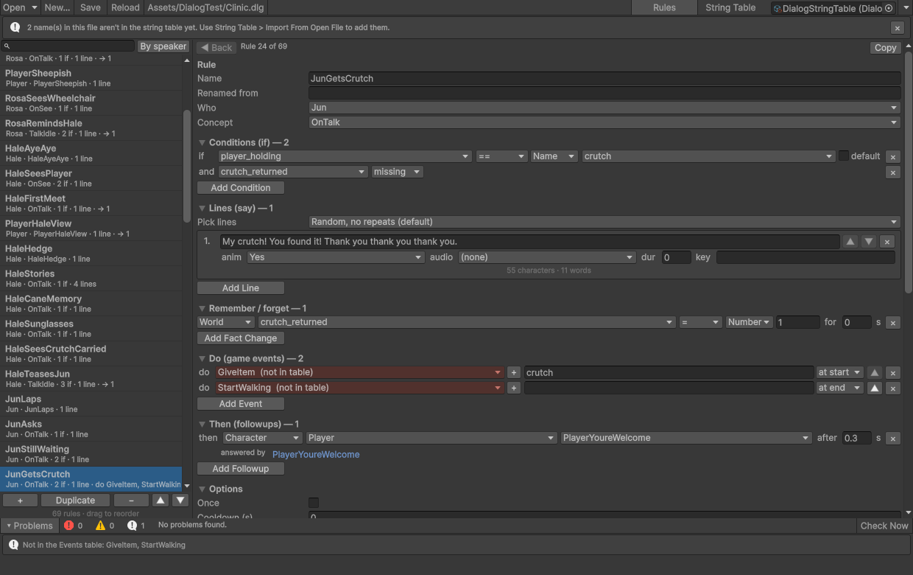
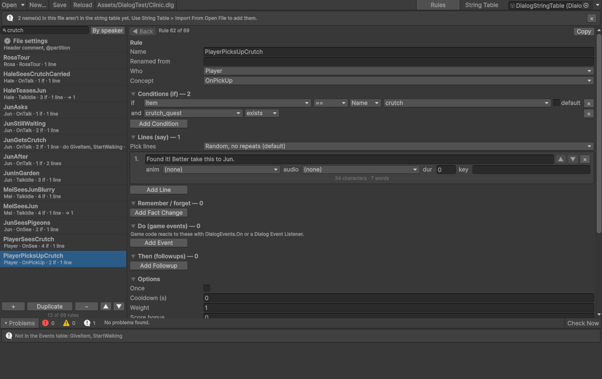
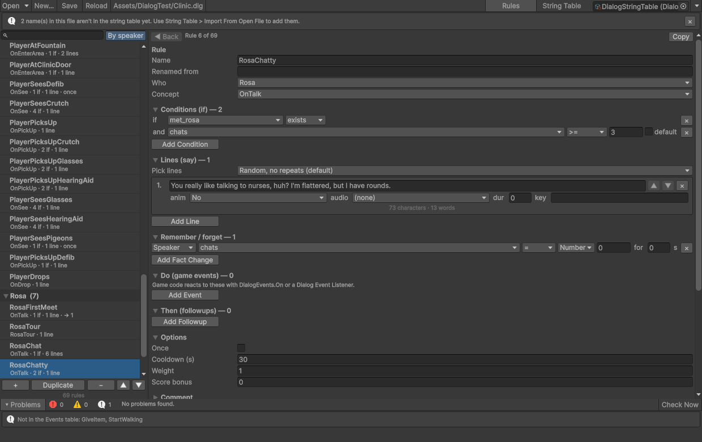
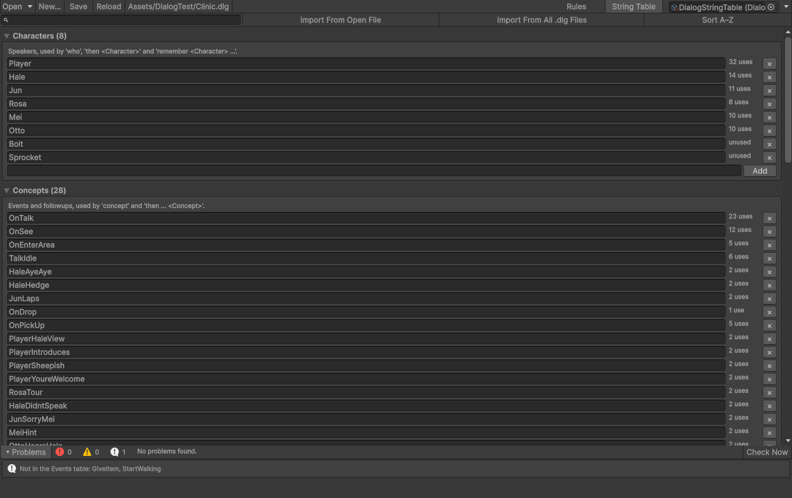

# Rule Editor

The Rule Editor edits `.dlg` files with forms and drop-downs, so writers don't need to learn the syntax. It reads and
writes ordinary `.dlg` files, so you can switch between it and a text editor at any time.

Open it with **Window > Dynamic Dialog > Rule Editor**, by right-clicking a `.dlg` file and choosing
**Dynamic Dialog > Edit in Rule Editor**, or with **Open in Rule Editor** in a `.dlg` file's inspector.

## The window

The toolbar has **Open** (a list of the project's `.dlg` files), **New…**, **Save** (Ctrl+S), **Reload**, and a menu
with **Show File in Project**, **Open File in Text Editor**, the **Debugger Window**, and a list of shortcuts.

The **Rules** tab has two halves:

- **The rule list** on the left. Click a rule to edit it. Drag rules to reorder them, or use **+**, **Duplicate**,
  **−** and the arrows. **By speaker** groups the list by who says each rule. Right-click a rule to copy it as `.dlg`
  text, paste rules from the clipboard below it, or move it to the top or bottom.
- **The selected rule** on the right, with a section for each part of a rule: **Name**, **Renamed from**, **Who**,
  **Concept**, conditions, lines (with **Pick lines**, the `select` mode), fact changes (`remember`/`forget`),
  game events (`do`), followups (`then`), and **Once**, **Cooldown**, **Weight** and **Score bonus**.

Below the rule are **Links to other rules** and a **Preview** of the rule as `.dlg` text.

The search box above the list filters it to rules that mention the text anywhere: in the name, speaker, concept,
lines, conditions, fact changes, events, followups or comment.

With **By speaker** on, each character's rules sit under a heading you can fold:

**Undo** and **Redo** work for every change. Keyboard shortcuts: ↑ and ↓ select rules, Ctrl+D duplicates,
Delete removes, Ctrl+C and Ctrl+V copy and paste rules as text, and Alt+← goes back to the previous rule after
following a link.

## Names from a string table

Fields that take a name (characters, concepts, facts, name values, animation triggers, audio clips and event names)
are searchable drop-downs. Type to filter; pick a name, or type a new one and add it with **+**.

The names come from a **Rule Editor String Table** asset. Create one from the window's **String Table** tab (filled
with the names the open file already uses), or with **Assets > Create > Dynamic Dialog > Rule Editor String Table**.
The tab can also **Import From Open File** or **Import From All .dlg Files**. Each category is a plain list you can
edit there or in the asset's inspector. The window remembers which table you used last.

A string table keeps everyone on a team using the same spelling. A fact typed as `said_intro` in one rule and
`saidIntro` in another is two different facts, and the drop-downs make that hard to do by accident.

## Problems, checked as you edit

The **Problems** panel re-checks the file as you edit: syntax that wouldn't load, followups that no rule answers,
contradictory conditions, likely typos in names, duplicate rule names, and `renamed` mistakes. Each rule also shows
its own problems at the top. Saving a file that would have errors asks first.

## Links between rules

For the selected rule, **Links to other rules** shows:

- **Led to by**: the rules whose followups reach this rule.
- For each followup: the rules that answer it. When none do, **Create Answer** adds a rule for the right speaker
  and concept.
- For each fact it checks: the rules that set that fact.
- For each fact it remembers: the rules that check it.
- For each event it raises: other rules that raise the same event.

Click a linked rule to jump to it, and **◀ Back** (Alt+←) to return.

## Renaming rules safely

Rules are saved by name, so renaming a rule that has `once` or a cooldown would make it forget its state in old save
games. After you rename such a rule, the editor shows a **Keep Saves** button, which adds the old name to
**Renamed from** (the `renamed` statement). See [Renamed rules](save-load.md#renamed-rules).

## Comments and formatting

Saving keeps the file's comments. A comment above a rule travels with it when the rule moves, and a comment inside a
rule is moved to just above it. The rules themselves are written in a standard layout: one statement per line,
indented two spaces.

If the file changes on disk while you have unsaved edits (someone saved it in a text editor, or version control
updated it), the window says so and offers **Reload From Disk** or **Keep Mine**.

## Hot reload

Saving from the Rule Editor during Play Mode swaps the new rules into the running game, the same as saving from a text
editor. See [Hot reload](hot-reload.md).
