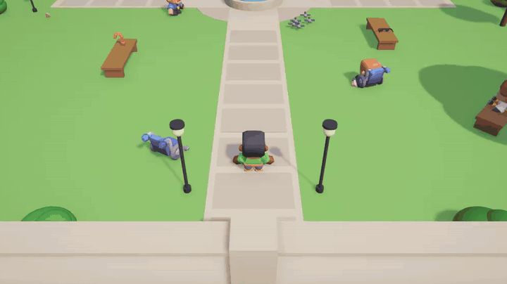

# Dynamic Dialog (Unity package)

Contextual dialog driven by a rule database. When something happens, a character asks "what should I say?". The package
gathers every fact about the moment (the world, the speaker, the event) into a **query**, finds every rule whose
conditions all pass, and plays the most specific one. Rules can write facts back into memory, hand a concept to another
character to start a conversation, and raise game events for your code.

Inspired by Elan Ruskin's GDC 2012 talk *"Rule Databases for Contextual Dialog and Game Logic"*. This package is an
independent implementation and uses no material from the talk.



*A small test scene: every line above is chosen by the rule database from what the characters know at that moment.*

## Documentation

The manual is in [`Documentation~`](Documentation~/index.md):

| Start | Write rules | Reference and tools | Topics |
|---|---|---|---|
| [Getting started](Documentation~/getting-started.md) | [The `.dlg` language](Documentation~/dlg-reference.md) | [Components](Documentation~/components.md) | [Showing lines and presenters](Documentation~/presenters.md) |
| [Concepts](Documentation~/concepts.md) | [Spreadsheets and the inspector](Documentation~/authoring-formats.md) | [Scripting](Documentation~/scripting.md) | [Localization](Documentation~/localization.md) |
| [Upgrading from 0.x](Documentation~/upgrading.md) | [Rule Editor](Documentation~/rule-editor.md) | [Debugger and Rule Validator](Documentation~/debugging.md) | [Saving and loading](Documentation~/save-load.md) |
| [FAQ and troubleshooting](Documentation~/faq.md) | | [Hot reload](Documentation~/hot-reload.md) | [Regions](Documentation~/regions.md) |

## Features

- Rules in `.dlg` text files, spreadsheets (`.dlgcsv`, `.dlgtsv`), the inspector, or the Rule Editor window, all
  hot-reloaded while the game plays.
- Memory per character and for the world, with expiring facts; `once`, cooldowns, weighted ties and line variations.
- Conversations through followups to a named character, the speaker itself, or whoever is in earshot.
- Game events (`do`) and fact-change notifications, so game code never depends on rule names.
- Speech bubbles and a subtitle bar (uGUI and TextMeshPro), or your own UI through `IDialogPresenter`.
- A Debugger that answers "why didn't this rule play?", rule coverage, test queries, and a Rule Validator.
- Localization (Unity Localization or your own), versioned save data that survives renamed rules, and region
  streaming (optionally through Addressables).
- Zero-allocation lookups, a core with no Unity dependency, and Unity 2021.3 LTS through Unity 6.

## Install

In Unity 2021.3 or later, install Dynamic Dialog from the Asset Store through Package Manager (**My Assets**). Or choose
**Add package from disk…** and select this folder's `package.json`, or **Add package from git URL…** if you have access
to the repository. Then follow [Getting started](Documentation~/getting-started.md),
which takes about ten minutes.

## A taste

```dlg
@who Nick                              # default speaker for the rules below

rule NickSwampIntro
  concept TalkIdle
  if map == swamp and survivors >= 3
  if said_intro missing                 # 0 or not set yet
  say "Man, this swamp." audio nick_swamp_01 duration 3s
  say "Cesspool of disease, is what this is."
  remember said_intro = 1
  do PlayMusic swamp_theme              # a game event for your code
  then Rochelle SwampReply after 1s     # Rochelle answers when this line ends
  once
```

## Samples

In Package Manager, select Dynamic Dialog, open the **Samples** tab, and import any of these. Open the sample's scene
and press Play. Each sample has a README, and every line is in the sample's `.dlg` file, which you can edit while playing.

| Sample | What it shows | Size |
|---|---|---|
| **First Bark** | The smallest scene: one character, one rule file and a speech bubble. Start here. | 22 KB |
| **Robot Banter** | Two robots wander a room and talk about what they see: specific rules beating general ones, memory, conversations, replies from whoever is in earshot, idle chatter, and interruptions. Uses the debug overlays. | 14 KB |
| **Courtyard Quests** | A playable clinic courtyard: five characters, three fetch quests and pigeons. Talking, seeing, areas, pick-ups, facts from code, game events (`do`), fact-change notifications, characters reacting to each other, and speech bubbles. Kenney CC0 art. | 4.9 MB |
| **Dialog UI** | The speech bubbles and subtitle bar side by side, a restyled bubble (a prefab variant), and a custom presenter (a chat log) built on `IDialogPresenter`. | 69 KB |

All samples work with any render pipeline: scenery is made from primitives at Play time with the pipeline's default
material. Courtyard Quests and Dialog UI read input from the Input System package when it's installed, and from the
old Input Manager otherwise. First Bark, Courtyard Quests and Dialog UI need uGUI and TextMeshPro, which new projects
include. If TextMeshPro's Essential Resources aren't in the project yet, importing a sample adds them.

The Kenney art in Courtyard Quests (Mini Characters, Input Prompts, Interface Sounds) is released under Creative
Commons Zero (CC0). Each pack's `License.txt` is in the sample's `Art/Kenney` folder, and only the files the sample
uses are included.

## Performance

Measured on a desktop PC (.NET 9, Release) with 10,000 rules in 200 buckets of 50 and about 8 criteria per rule,
the scale the talk describes:

| Operation | Time | Garbage |
|---|---|---|
| `RuleMatcher.FindBest` | 0.84 µs | 0 B |
| `DialogEngine.Ask` (build a ~40-fact query from memory and providers, then match) | 0.71 µs | 0 B |
| The same with lookup recording on | 2.7 µs | about 2.5 KB (7.4 KB before 1.0) |
| One 10,000-rule bucket (no partitioning, for comparison) | 45 µs | 0 B |
| `RuleMatcher.FindBest` inside the Unity 6.5 editor (Mono, editor code optimization) | 4.0 µs | 0 B |

**Garbage per lookup in Unity,** through the real components: a Dialog Director with its built-in `map` and
`speakers_talking` facts, and three speakers with Static Facts and Nearby Speaker Facts (Unity 6000.5 editor, Play Mode):

| Lookup | 0.6 | 1.0 |
|---|---|---|
| `speaker.Speak(concept)` with no matching rule (an idle poll) | 200 B | 0 B |
| `DialogEngine.Ask` with a match | 200 B | 0 B |
| The same with lookup recording on (editor and development builds) | 4.2 KB | 1.5 KB |

The 0.6 garbage came from reading the scene name and from enumerating lines and speakers through interfaces, on every query.
Lookup recording still allocates what each record keeps: a copy of the query, where each fact came from, and the rules tested.
Release builds don't record. A line that actually plays allocates its `DialogLine` and whatever your presenters do.

The matcher loads each query into a table indexed by symbol, so each condition costs one array read.
The Play Mode tests check for zero garbage under Unity's own runtime, both in the core and through the components, and
`AllocationMeasureTests` logs the numbers above. To rerun the .NET numbers:

```bash
dotnet run -c Release --project "Tests~/DotNet/Bench"
```

## Compatibility

- **Unity versions:** 2021.3 LTS through Unity 6 (6000.x). 1.0 was tested on 2021.3.45f2 and 6000.5.5f1.
- **Optional packages:** Addressables (Dialog Addressable Region), Localization (Unity Localization Localizer), and uGUI with
  TextMeshPro (speech bubbles and subtitle bar) each live in their own assembly, which only compiles when its packages are
  installed. Without them the rest of the package compiles and works, with no errors or warnings.
- **Enter Play Mode Options:** works with *Reload Domain* off. Each time Play Mode starts, the package clears its static state
  (the director instance, `DialogSpeaker.AnyLineStarted`/`AnyLineEnded` subscribers, `DialogEvents` handlers and registered
  presenters), and rule databases start over with fresh `once`, cooldown and variation state. Your own static subscriptions
  to those events are cleared too, so subscribe in `OnEnable` or `Start`, not in a static constructor.
  `DialogDirector.Initialized` is kept, for editor tools.
- **Player builds and code stripping:** the package uses no reflection at runtime, so it needs no `link.xml`, even with
  Managed Stripping Level set to High. A Windows Mono player with High stripping was run, and an Android IL2CPP player
  was built, for 1.0.

## Versioning and support

**Semantic versioning.** From 1.0.0, version numbers follow [Semantic Versioning](https://semver.org):

- **Patch** releases (1.0.x) fix bugs. They don't change the public API, the `.dlg` and spreadsheet formats, or the save format.
- **Minor** releases (1.x.0) add features. Existing code, rule files and saves keep working. A member may be marked
  `[Obsolete]` in a minor release, with a message naming its replacement, but it keeps working until the next major release.
- **Major** releases (2.0.0) may break things. Every break is listed in the [changelog](CHANGELOG.md) with a migration note,
  and saves from earlier versions keep loading (`DialogSaveData.Upgrade()` migrates them).

The public API is every public type and member in the runtime assemblies (`DynamicDialog.Core`, `DynamicDialog`, and the
optional `DynamicDialog.Presentation`, `DynamicDialog.Addressables` and `DynamicDialog.Localization`), plus the editor
entry points the manual documents. Anything `internal`, and anything in the samples, may change in any release.

**Supported Unity versions.** Unity 2021.3 LTS through Unity 6 (6000.x). Each release is tested on the oldest and newest
of these (1.0.0: 2021.3.45f2 and 6000.5.5f1). Support for a Unity version is only dropped in a major release, and new
Unity versions are added in minor or patch releases. Tech-stream (non-LTS) releases in between should work but aren't tested.

**Reporting bugs.** Use the support contact on the package's Asset Store page. Please include the package version
(Package Manager shows it), your Unity version, the console error with its stack trace, and, if you can, the rule file
or a small scene that shows the problem. The Debugger's **Lookups** tab often shows exactly why a line did or didn't
play; a screenshot of it helps. Check [FAQ and troubleshooting](Documentation~/faq.md) first.

## License

Dynamic Dialog is sold under the [Unity Asset Store EULA](https://unity.com/legal/as-terms); see [LICENSE.md](LICENSE.md).
It is not open source. The Courtyard Quests sample includes Kenney art released under CC0; see
[Third Party Notices.md](Third%20Party%20Notices.md).

## Tests

`Tests/Editor` holds the core NUnit tests (EditMode), `Tests/EditorIntegration` tests the importers and editor tools,
and `Tests/Runtime` holds Play Mode tests for the components. `Tests/Presentation` holds Play Mode tests for the speech bubble
and subtitle bar prefabs (they need TMP Essential Resources imported).
`DocumentationTests` checks the manual: every `.dlg` and spreadsheet example must parse cleanly, and every C# example
must match code in a `DocumentationSnippets.cs` file under `Tests/`, which the test assemblies compile.
To run them in Unity, add `"testables": ["com.dynamicdialog"]` to your project's `Packages/manifest.json`.
The core tests also run outside Unity:

```bash
dotnet test "Tests~/DotNet/Tests/DynamicDialog.Core.Tests.csproj"
```

`Tests~/DotNet/Core` builds `Runtime/Core` against `netstandard2.1` with warnings treated as errors.
That catches any API Unity doesn't provide. `Tests~/DotNet/Unity` compile-checks `Runtime/Unity` against an installed editor's DLLs
(set `-p:UnityManaged=...` if yours isn't 6000.5.5f1). `Tests~/DotNet/Presentation` does the same for `Runtime/Presentation`;
uGUI and TextMeshPro are packages, so it also needs a Unity project's compiled `Library/ScriptAssemblies`
(`-p:UnityScriptAssemblies=...`). Unity ignores folders whose names end in `~`.

### Continuous integration

GitHub Actions (`.github/workflows`) runs on every pull request and push to `main`:

- **.NET tests**: the `netstandard2.1` core build and `dotnet test`. Needs no Unity license.
- **Unity tests** (GameCI): Edit Mode and Play Mode tests on Unity 2021.3.45f2 and 6000.5.5f1, each with all optional
  packages installed (uGUI and TextMeshPro, Addressables, Localization) and with none. They need Unity license secrets,
  and are skipped with a warning until those are set.
- A **player build smoke test** (First Bark, Linux IL2CPP) runs when started by hand.

Test results are uploaded as artifacts. `CI~/README.md` explains the generated host project and how to set the
license secrets.
